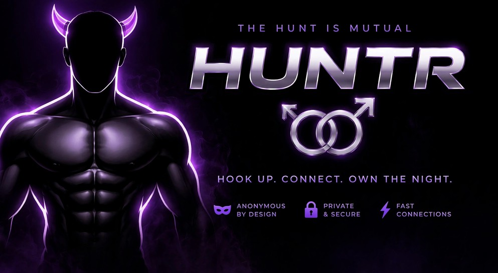
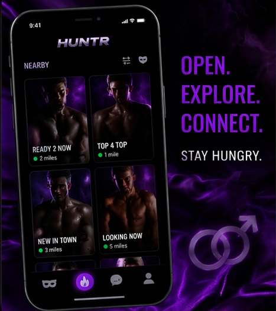
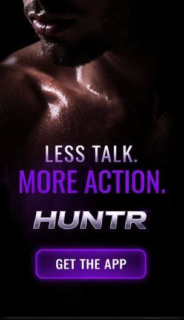

# HÜNTR

**Find. Fuck. Repeat.**

HÜNTR is the hookup app for gay men who are done wasting time. No dating games, no endless chatting, no flakes — just guys near you who are actually looking, right now.

Built from the ground up to fix everything broken about the other apps — at **less than half the price** of Grindr's premium.

**18+ only. Men seeking men.**

---

## ⬇️ Download

**[Download the latest Android APK here](https://github.com/chaosdemonhank/huntr/releases/download/v4.0.2/app-release.apk)**

Current version: **v4.0.2** · Size: **84 MB**

### 📱 On iPhone? Use the web version

**[Open HÜNTR in your browser — get.huntrmail.xyz/app](https://get.huntrmail.xyz/app/)**

No download, no App Store, nothing to install. The web version is the full HÜNTR — same account, same grid, same PLUS — and it works on iPhone, iPad, and any computer browser.

**Make it feel like a real app on iPhone:** open the link in **Safari**, tap the **Share** button, then **Add to Home Screen**. HÜNTR lands on your home screen with its own icon and opens full-screen, just like a native app.

🌐 **Landing page:** [chaosdemonhank.github.io/huntr](https://chaosdemonhank.github.io/huntr/) — same download, prettier page.

### 🎁 Launch offer — PLUS free for a FULL YEAR

The first **25 guys in each launch city** who create a profile get **HÜNTR PLUS free for a full year** — complete access to everything, unlimited. Launch cities: Knoxville, Asheville, Nashville, Atlanta, Charlotte, Chicago, Dallas, Houston, Miami, New York City, Los Angeles, San Francisco, Seattle, Denver, Las Vegas. The landing page shows a live spots-left counter per city — when your city's 25 are gone, they're gone.

### Requirements

**Android app:**
- **Android 7.0 or newer** (any Android phone from roughly 2016 on)
- ~100 MB of free space
- An internet connection

**Web version (iPhone / iPad / computer):**
- Any modern browser (Safari, Chrome, Firefox, Edge)
- An internet connection — that's it

### How to install (takes about a minute)

HÜNTR is distributed directly, not through Google Play — so Android will ask you to approve the install. That's normal for any app installed this way:

1. Tap the download link above and let the APK finish downloading.
2. Open the downloaded file (`app-release.apk`) from your notifications or Downloads folder.
3. If Android asks, tap **Settings** and allow **"Install unknown apps"** for your browser, then go back. You only do this once.
4. Tap **Install**.
5. Google Play Protect may show a warning because the app isn't from the Play Store. Tap **"Install anyway"** — this warning appears for every directly-distributed app.
6. Open HÜNTR, create your account, and confirm you're 18+.

> **Only ever download HÜNTR from this GitHub repo.** If a site asks you to pay for the APK itself or download it from somewhere else, it's not us — the app is always free to download here; PLUS is paid inside the app.

---

## Why HÜNTR hits different

### 🚫 The Flake Killer — real accountability, built in
Every other app lets guys waste your night with zero consequences. HÜNTR doesn't.

Our background accountability system tracks the stuff everybody's sick of:

- **Blocking after a meet is planned**
- **No-shows**
- **Pic collectors** — guys who take your pics and never send theirs

**5 strikes in one category within 30 days — or 7 total — and you're banned. Automatically.** No reports to file, no begging moderators. The system watches so you don't have to. Serious guys stay. Time-wasters get shown the door.

### 📍 A grid of guys who are actually around
The grid runs on live presence — guys active in the last few minutes surface first with a live indicator, so you're not messaging profiles that haven't opened the app in a week.

### 🕐 Know the deal before you say a word
Every profile shows what matters up front:

- **Timeframe:** NOW · TODAY · TONIGHT
- **Logistics:** CAN HOST · MUST TRAVEL · OPEN TO EITHER

Filter for **NOW** and see only the guys ready to go. No more twenty questions just to find out he can't host and neither can you.

### 📌 Meets — plan it in the app, not in circles
When it's time, drop a **meet pin** right in chat. The meet has a real flow — planned, en route, arrived — and the exact address details (unit, buzzer) stay **locked until the traveler is actually on his way**. You get the info when you need it, not before. Safer for the host, clearer for the guest.

### 💬 Chat that does what you need
- **View-once photos** that disappear after they're seen
- **Pin drops** and live transit updates inside the conversation
- Normal text when that's all it takes

### 🛡️ Moderation with teeth
- **Block = total purge.** Both directions, conversation gone from both sides. Done means done.
- **Report = evidence frozen.** The full transcript is locked and saved for review, and you're shielded from the reported user immediately.
- **Ban evasion doesn't work.** Accounts are tied to a privacy-safe device fingerprint (hashed — your raw device data is never stored), so banned means banned.

---

## A look at HÜNTR

 

---

## HÜNTR PLUS — $9.99/month

Everything above, unlocked to the max — for **less than half of what Grindr charges** for premium. Same game, better app, lower price. Do the math.

---

## Privacy, straight up

- Device fingerprints are stored as **one-way hashes only** — never raw device data
- View-once pics are view-once
- Block purges go both ways, completely
- Your exact meet address is revealed progressively, only when your guest is en route

---

## FAQ

**Why isn't HÜNTR on Google Play?**
Google doesn't allow 18+ hookup apps on the Play Store. Distributing directly means no store gatekeepers, no store fees — and it's a big reason PLUS can cost $9.99 instead of what the other guys charge.

**How do I pay for PLUS if there's no Play Store billing?**
Right inside the app, by card, through Stripe (the same payment processor used by millions of businesses). No Google account needed, cancel anytime in the app.

**Is the APK safe?**
The APK is digitally signed, and Android verifies that signature on install and on every update — an update only installs if it was signed with the same key as your existing copy. Only download from this official repo so you know you're getting the real file.

**Is there an iPhone version?**
Yes — the **web version**: [get.huntrmail.xyz/app](https://get.huntrmail.xyz/app/). Apple doesn't allow direct app installs the way Android does, so on iPhone HÜNTR runs in the browser instead of as a native app. It's the full HÜNTR with the same account, and if you open it in Safari and choose **Add to Home Screen**, it sits on your home screen and opens full-screen like a regular app. A native iOS app is still on the roadmap.

**How do strikes actually work?**
The system runs in the background — nobody files reports. Once a meet has actually been planned, blocking the other guy, no-showing, or collecting his pics without sending yours each earn a strike in that category. **5 strikes in one category within 30 days, or 7 total, triggers an automatic ban**, and the ban sticks to the device, not just the account. Normal chatting, browsing, and changing your mind *before* a meet is planned never earn strikes.

**I got banned / something's broken / I need help.**
Open an issue here: **[github.com/chaosdemonhank/huntr/issues](https://github.com/chaosdemonhank/huntr/issues)** — that's the official support and bug-report channel. Appeals are read by a human.

---

## The bottom line

Other apps profit from keeping you scrolling. HÜNTR is built to get you off the app and into the meet — with a system that punishes flakes instead of rewarding them.

**Find. Fuck. Repeat.**

*HÜNTR is strictly for adults 18+. By downloading, you confirm you are of legal age in your area.*
